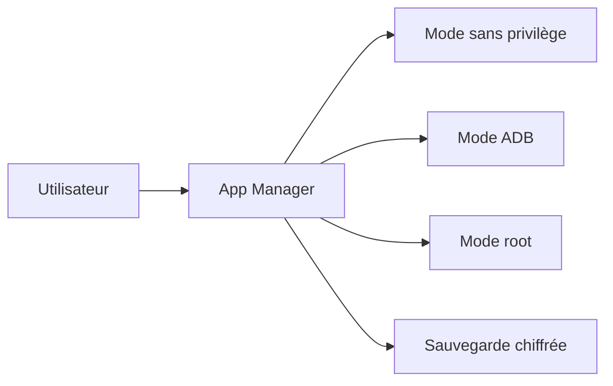

# MuntashirAkon/AppManager

> A free Android application that inspects, backs up and controls installed apps, with or without root.

## The problem
Android hides most of an application's details: components, permissions, trackers. Several tools are needed to see and change them.

## What it actually does
Lists an app's activities, services, permissions and libraries, spots trackers, installs APKs (APKS, APKM, XAPK) and makes encrypted backups. With ADB or root: revoke permissions, freeze apps, block components. Includes a logcat, an editor, a file manager and a simple terminal.

## How it is wired

## Trying it
No documented command. Install via F-Droid (package `io.github.muntashirakon.AppManager`); to build: see BUILDING.rst.

## Cost and gotchas
Free. The most powerful features require root or ADB, and modifying system apps can break the device. The README states the copyleft GPLv3+ but GitHub does not identify the license.

## What it is not
Not a complete mobile security tool. The "upcoming" features (APK editing, crash monitor…) do not exist yet.

## Alternatives
No alternative named in the README (Aurora Store and F-Droid clients are mentioned as possible ways to open apps).

## For you
Keep an eye on it: outside the data/AI scope, useful only if you audit Android apps; a single maintainer and a license to confirm.
