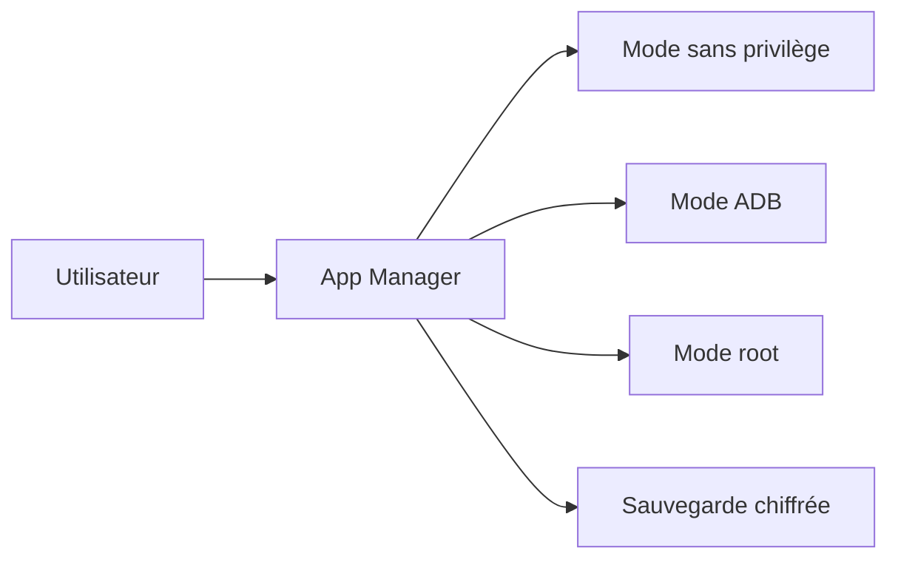

# MuntashirAkon/AppManager

> Application Android libre qui inspecte, sauvegarde et contrôle les applications installées, avec ou sans root.

## Le problème
Android cache la plupart des détails d'une application : composants, permissions, traqueurs. Il faut plusieurs outils pour les voir et les modifier.

## Ce que ça fait vraiment
Liste activités, services, permissions et bibliothèques d'une app, repère les traqueurs, installe des APK (APKS, APKM, XAPK) et fait des sauvegardes chiffrées. Avec ADB ou root : révoquer des permissions, geler des apps, bloquer des composants. Inclut un logcat, un éditeur, un gestionnaire de fichiers et un terminal simple.

## Comment c'est branché

## Essayer
Aucune commande documentée. Installation via F-Droid (paquet `io.github.muntashirakon.AppManager`) ; compilation : voir BUILDING.rst.

## Coût et pièges
Gratuit. Les fonctions les plus puissantes demandent root ou ADB, et modifier des apps système peut casser l'appareil. Le README annonce le copyleft GPLv3+ mais GitHub n'identifie pas la licence.

## Ce que ce n'est pas
Pas un outil de sécurité mobile complet. Les fonctions « upcoming » (édition d'APK, crash monitor…) n'existent pas encore.

## Alternatives
Aucune alternative nommée dans le README (Aurora Store et clients F-Droid sont cités comme ouvertures possibles).

## Pour toi
À surveiller : hors du périmètre data/IA, utile seulement si tu audites des apps Android ; un seul mainteneur et une licence à confirmer.

