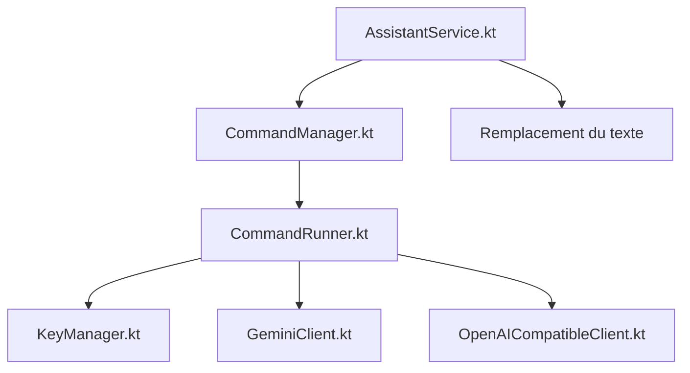

# Musheer360/SwiftSlate

> Android AI assistant that rewrites your text in any application when you type a trigger such as ?fix.

## The problem
Fixing or rephrasing text with an LLM means copy-pasting between the application and a chatbot.

## What it actually does
An accessibility service detects a trigger at the end of the text, sends the text to Gemini, Groq or an OpenAI-compatible endpoint (Ollama possible), then replaces the text in place. Editable AI commands, offline local commands, rotation across several keys, a text-selection menu.

## How it is wired


## Trying it
```bash
git clone https://github.com/Musheer360/SwiftSlate.git
cd SwiftSlate
./gradlew assembleDebug
adb install app/build/outputs/apk/debug/app-debug.apk
```

## Cost and gotchas
An API key is required for the AI commands; it is free with Gemini within the quota. It asks for the accessibility permission, so the text you type is read to detect the trigger. Android 6 minimum.

## What it is not
It does not work everywhere: some custom editors and WeChat fail, hence the selection menu. No iOS version.

## Alternatives
- SwiftSlate Desktop: same principle for Windows 10 and 11.

## For you
Worth watching: the idea is useful and the keys are encrypted, but granting accessibility to an application run by a single person is a matter of trust.
