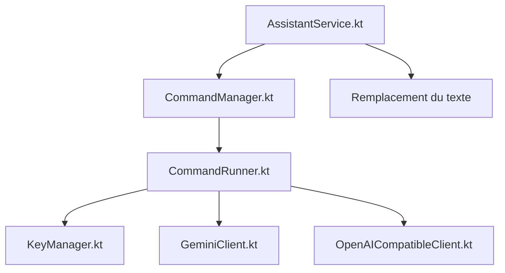

# Musheer360/SwiftSlate

> Assistant IA Android qui réécrit ton texte dans n'importe quelle application quand tu tapes un déclencheur comme ?fix.

## Le problème
Corriger ou reformuler un texte avec un LLM oblige à copier-coller entre l'application et un chatbot.

## Ce que ça fait vraiment
Un service d'accessibilité détecte un déclencheur en fin de texte, envoie le texte à Gemini, Groq ou un point d'accès compatible OpenAI (Ollama possible), puis remplace le texte sur place. Commandes IA modifiables, commandes locales hors ligne, rotation de plusieurs clés, menu de sélection de texte.

## Comment c'est branché


## Essayer
```bash
git clone https://github.com/Musheer360/SwiftSlate.git
cd SwiftSlate
./gradlew assembleDebug
adb install app/build/outputs/apk/debug/app-debug.apk
```

## Coût et pièges
Clé d'API requise pour les commandes IA, gratuite chez Gemini dans la limite du quota. Demande l'autorisation d'accessibilité, donc le texte tapé est lu pour détecter le déclencheur. Android 6 minimum.

## Ce que ce n'est pas
Ne fonctionne pas partout : certains éditeurs personnalisés et WeChat échouent, d'où le menu de sélection. Pas de version iOS.

## Alternatives
- SwiftSlate Desktop : même principe pour Windows 10 et 11.

## Pour toi
À surveiller : l'idée est utile et les clés sont chiffrées, mais accorder l'accessibilité à une application d'une seule personne est un choix de confiance.

