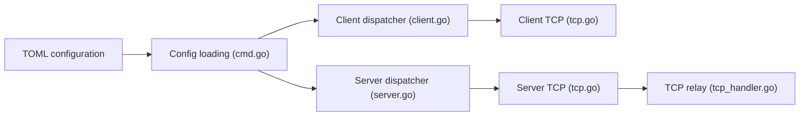

# Musixal/Backhaul

> Reverse tunnel in Go that crosses NAT and firewalls, to expose a server behind a network restriction.

## The problem
A service placed behind a NAT or a firewall is not reachable from outside.

## What it actually does
A client behind the NAT opens the connection to a server, which exposes forwarded ports. TCP, WebSocket and WSS transports, SMUX multiplexing, UDP encapsulated in TCP, TLS, authentication token, web monitoring interface, hot configuration reload. Configuration through a TOML file.

## How it is wired


## Trying it
```bash
tar -xzf backhaul_linux_amd64.tar.gz
./backhaul -c config.toml
git clone https://github.com/musixal/backhaul.git && cd backhaul && go build
```

## Cost and gotchas
Free; a public server is needed on one side. TLS certificate to generate yourself for wss. AGPL-3.0. Last push on 2025-09-04.

## What it is not
Not a VPN nor a turnkey security tool: the token is not encrypted on non-TLS transports. The README contains a donation address.

## Alternatives
No alternative named in the README.

## For you
Ignore: a network tool unrelated to data or MLOps, and with no activity for over a year.
