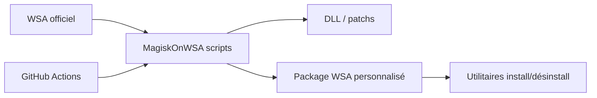

# MustardChef/WSABuilds

> Builds of the Windows Subsystem for Android with Magisk, KernelSU and Google Play, for Windows 10/11 users.

## The problem
Microsoft ended WSA on March 5, 2025, while users still want to run Android apps on Windows with root and Google services.

## What it actually does
The repository repackages the official WSA: scripts (Python, PowerShell, Bash) and GitHub Actions workflows patch it, inject Magisk, KernelSU and optionally GApps, then produce archives and installers. It is in LTS mode: the README announces updates of the bundled versions. It reports crashes of GApps builds on Windows 11 since June 2025 and apps being blocked after September 1, 2026 without an LTS update.

## How it is wired

## Trying it
The README documents no command, only download links (Windows 10/11 x64, LTS versions).

## Cost and gotchas
Free, but 8 GB RAM minimum (16 recommended), virtualization enabled, 10 GB free on NTFS. Product not supported by Microsoft; known bugs with some GPUs.

## What it is not
Not an official Microsoft project, nor a lasting solution: the underlying platform is no longer supported.

## Alternatives
The README cites MagiskOnWSA, WSAPatch and MagiskOnWSALocal as integrated building blocks.

## For you
Ignore: an Android tinkering tool on Windows, unrelated to your field, on an abandoned platform.
