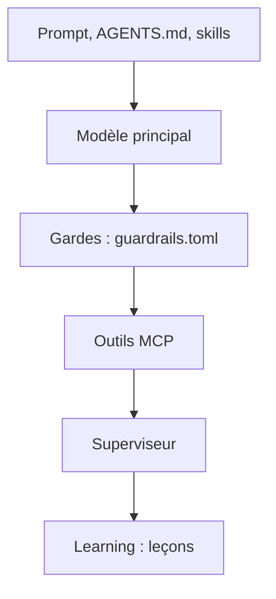

# Muvon/octomind

> Open-source coding agent harness in a single Rust binary, with TOML guardrails and a supervisor model.

## The problem
Coding agents ask for human approval at every risky step, which blocks CI or background use.

## What it actually does
Octomind gives an LLM tools via MCP (files, shell, search, sub-agents) and is used as a CLI, pipe, daemon, WebSocket or ACP. The rules live in `.agents/guardrails.toml` (pre-call guards, hooks, validators). A second model supervises the plan and rejects an unproven "done". Lessons are extracted at the end of a session.

## How it is wired


## Trying it
```bash
curl -fsSL https://raw.githubusercontent.com/muvon/octomind/master/install.sh | bash
octomind login
octomind run developer:general
echo "Explain the auth module" | octomind run developer:general --format plain
```

## Cost and gotchas
Models via Octomind Cloud (account) or your own key (OpenRouter, Anthropic, OpenAI…), at your expense; budget can be capped. Anonymous telemetry, can be disabled with `DO_NOT_TRACK=1`.

## What it is not
The benchmarks (24/25 versus 19/25 for OpenCode) are the author's own, on 25 tasks: reproduce them before relying on them. It is not a model.

## Alternatives
- Claude Code: the reference agent, compared in the benchmarks.
- Codex: OpenAI's agent, cheaper in the table.
- OpenCode: same category, compared with an identical model.

## For you
Watch: declarative guardrails for running in CI are of interest to an MLOps profile, but the figures come from the author.
