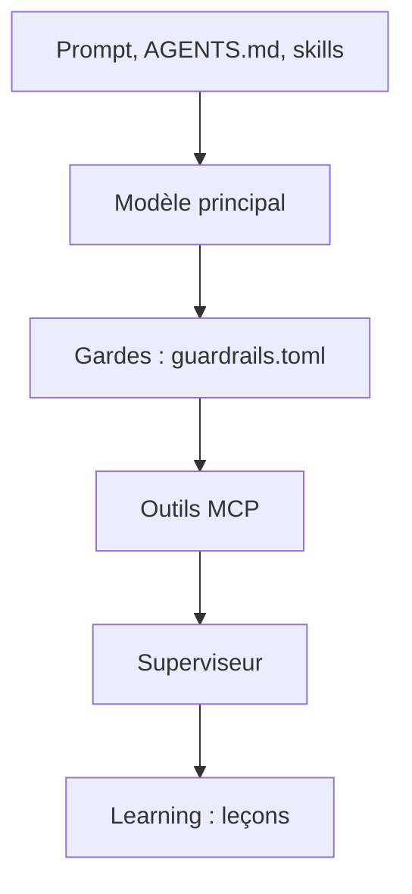

# Muvon/octomind

> Harnais d'agent de code open source en un binaire Rust, avec garde-fous en TOML et modèle superviseur.

## Le problème
Les agents de code demandent une validation humaine à chaque étape risquée, ce qui bloque les usages en CI ou en tâche de fond.

## Ce que ça fait vraiment
Octomind donne à un LLM des outils via MCP (fichiers, shell, recherche, sous-agents) et s'utilise en CLI, pipe, démon, WebSocket ou ACP. Les règles vivent dans `.agents/guardrails.toml` (gardes avant appel, hooks, validateurs). Un second modèle supervise le plan et refuse un « terminé » non prouvé. Des leçons sont extraites en fin de session.

## Comment c'est branché


## Essayer
```bash
curl -fsSL https://raw.githubusercontent.com/muvon/octomind/master/install.sh | bash
octomind login
octomind run developer:general
echo "Explain the auth module" | octomind run developer:general --format plain
```

## Coût et pièges
Modèles via Octomind Cloud (compte) ou ta propre clé (OpenRouter, Anthropic, OpenAI…), à ta charge ; budget plafonnable. Télémétrie anonyme, désactivable avec `DO_NOT_TRACK=1`.

## Ce que ce n'est pas
Les benchmarks (24/25 contre 19/25 pour OpenCode) sont ceux de l'auteur, sur 25 tâches : à reproduire avant de s'y fier. Ce n'est pas un modèle.

## Alternatives
- Claude Code : agent de référence, comparé dans les benchmarks.
- Codex : agent OpenAI, moins cher dans le tableau.
- OpenCode : même catégorie, comparé à modèle identique.

## Pour toi
Surveiller : les garde-fous déclaratifs pour tourner en CI intéressent un profil MLOps, mais les chiffres viennent de l'auteur.

