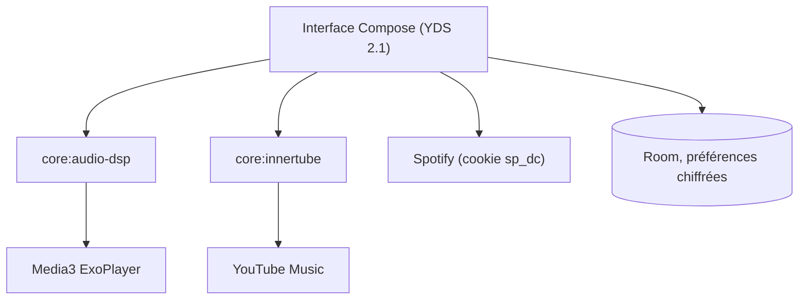

# MuwMx/YumaPlayer

> Android music player that combines Spotify and YouTube Music catalogues, FLAC and local playback.

## The problem
The Spotify and YouTube Music catalogues live in separate apps, with no gapless playback and no FLAC.

## What it actually does
Android app built with Jetpack Compose and Media3. It shows the Spotify and YouTube Music catalogues and provides a two-deck crossfade, a 5-band equalizer and local file playback. Synced lyrics come from several providers, with translation. FLAC goes through a third-party service (Qobuz / QBDLX) using your own credentials.

## How it is wired
Simplified diagram based on the fiche, no diagram supplied.



## Trying it
```bash
git clone https://github.com/MuwMx/YumaPlayer.git
cd YumaPlayer
./gradlew assembleRelease
```

## Cost and gotchas
Free; build with Android Studio, JDK 21 and SDK 37. Sign-in relies on session cookies from third-party services, and using them may contradict their terms.

## What it is not
Not a product affiliated with Google or Spotify (the README says so). FLAC streaming depends on unofficial sources. It has no connection to data or AI work.

## Alternatives
No alternative named in the README.

## For you
Ignore: a consumer Android app unrelated to a data or MLOps profile, and a grey area regarding access to the services.
