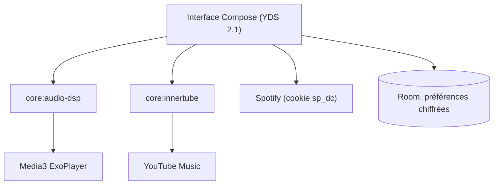

# MuwMx/YumaPlayer

> Lecteur de musique Android qui combine catalogues Spotify et YouTube Music, FLAC et lecture locale.

## Le problème
Les catalogues Spotify et YouTube Music sont dans des applications séparées, sans lecture sans coupure ni FLAC.

## Ce que ça fait vraiment
Application Android en Jetpack Compose et Media3. Elle affiche les catalogues Spotify et YouTube Music, gère un crossfade à deux platines, un égaliseur 5 bandes et la lecture de fichiers locaux. Les paroles synchronisées viennent de plusieurs fournisseurs, avec traduction. Le FLAC passe par un service tiers (Qobuz / QBDLX) avec tes propres identifiants.

## Comment c'est branché
Schéma simplifié d'après la fiche, sans diagramme fourni.



## Essayer
```bash
git clone https://github.com/MuwMx/YumaPlayer.git
cd YumaPlayer
./gradlew assembleRelease
```

## Coût et pièges
Gratuit ; compilation avec Android Studio, JDK 21 et SDK 37. La connexion repose sur des cookies de session de services tiers dont l'usage peut contredire leurs conditions.

## Ce que ce n'est pas
Pas un produit affilié à Google ni Spotify (le README le dit). Le streaming FLAC dépend de sources non officielles. Il n'a aucun lien avec le travail data ou IA.

## Alternatives
Aucune alternative nommée dans le README.

## Pour toi
À ignorer : application grand public Android sans rapport avec un profil data ou MLOps, et zone grise sur les accès aux services.

