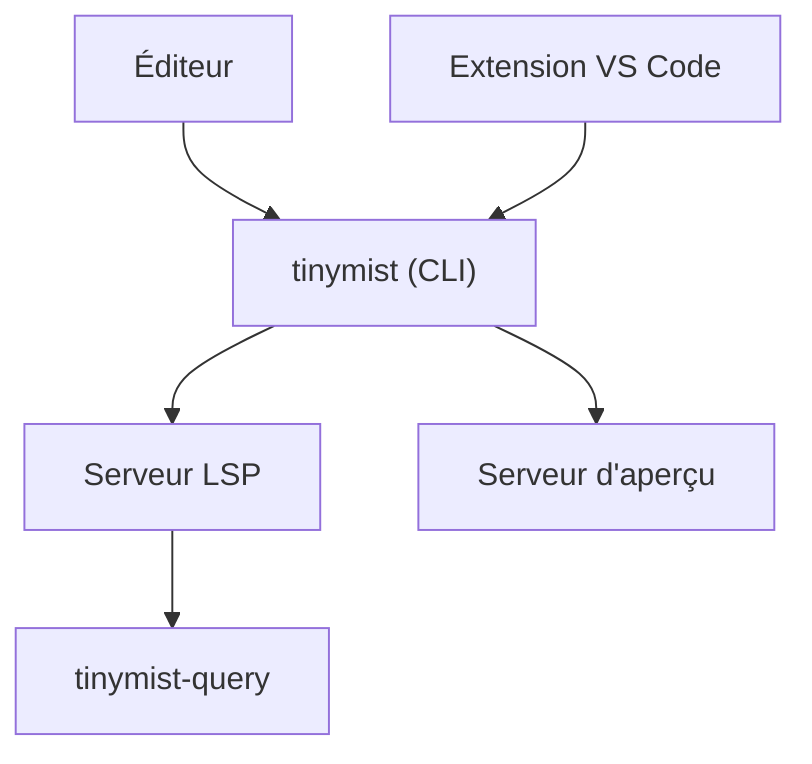

# Myriad-Dreamin/tinymist

> Integrated language service for Typst: LSP server, preview and VS Code extension.

## The problem
Writing Typst without completion, navigation or live preview is painful.

## What it actually does
- LSP server: semantic highlighting, definitions, references, hover, formatting, renaming.
- Compiles to PDF on save, and to SVG, PNG, HTML, Markdown.
- Preview server, linting, tests and template gallery.
- Editors: VS Code, Neovim, Emacs, Sublime Text, Helix, Zed.

## How it is wired
Simplified diagram based on the sheet, no diagram provided.


## Trying it
```bash
curl -sSL https://github.com/hongjr03/tinymist-nightly-installer/releases/latest/download/run.sh | bash
```

## Cost and gotchas
Free. Odd version = nightly, even = stable; nightlies use Typst's main branch. Inlay hints are disabled by default.

## What it is not
Not a full Typst compiler. The nightly install script comes from a third party (hongjr03).

## Alternatives
No alternative named in the README.

## For you
Ignore unless you write your reports in Typst: it brings preview and completion, nothing for data.
