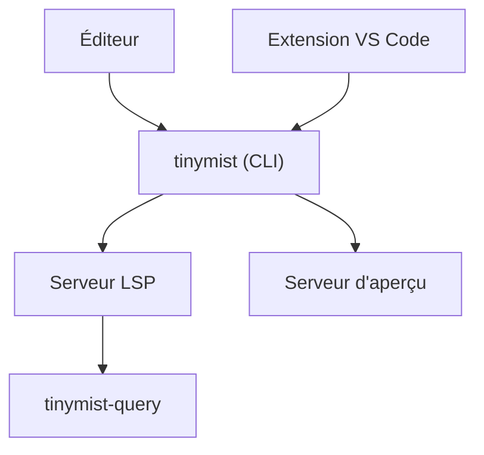

# Myriad-Dreamin/tinymist

> Service de langage intégré pour Typst : serveur LSP, aperçu et extension VS Code.

## Le problème
Écrire du Typst sans complétion, navigation ni aperçu en direct est pénible.

## Ce que ça fait vraiment
- Serveur LSP : coloration sémantique, définitions, références, survol, formatage, renommage.
- Compile en PDF à l'enregistrement, et en SVG, PNG, HTML, Markdown.
- Serveur d'aperçu, linting, tests et galerie de modèles.
- Éditeurs : VS Code, Neovim, Emacs, Sublime Text, Helix, Zed.

## Comment c'est branché
Schéma simplifié d'après la fiche, sans diagramme fourni.


## Essayer
```bash
curl -sSL https://github.com/hongjr03/tinymist-nightly-installer/releases/latest/download/run.sh | bash
```

## Coût et pièges
Gratuit. Version impaire = nightly, paire = stable ; les nightly utilisent la branche principale de Typst. Les inlay hints sont désactivés par défaut.

## Ce que ce n'est pas
Pas un compilateur Typst à part entière. Le script d'installation nightly vient d'un tiers (hongjr03).

## Alternatives
Aucune alternative nommée dans le README.

## Pour toi
À ignorer sauf si tu rédiges tes rapports en Typst : il apporte l'aperçu et la complétion, rien pour la donnée.

