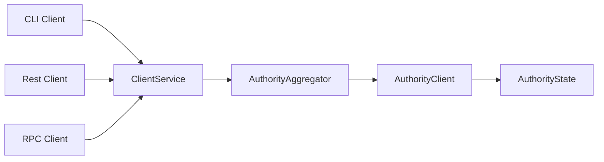

# MystenLabs/sui

> Smart contract platform in Rust with the Move language, for blockchain application developers.

## The problem
Classic blockchains route everything through consensus, which limits throughput and latency for payments or asset exchanges.

## What it actually does
Sui is maintained by an open set of authorities. Simple transactions are processed in parallel without consensus; contracts are written in Move and define assets with owners. The SUI token pays for gas and is used for stake delegation.

## How it is wired

## Trying it
No command documented in the README: it points to the Sui documentation.

## Cost and gotchas
The code is free, but real usage goes through the SUI token (gas). 875 open issues.

## What it is not
It is not a data or AI library. The README's performance claims are the publisher's own, not verified here.

## Alternatives
No alternative named in the README.

## For you
Ignore for a data / AI / MLOps profile: it is a blockchain platform with no link to data or model pipelines.
