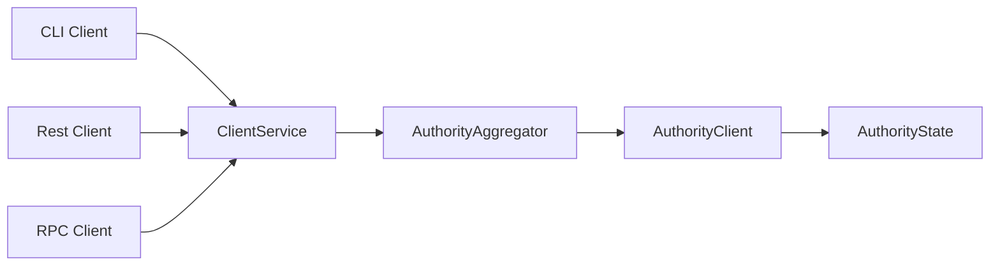

# MystenLabs/sui

> Plateforme de contrats intelligents en Rust avec le langage Move, pour développeurs d'applications blockchain.

## Le problème
Les blockchains classiques passent tout par un consensus, ce qui limite débit et latence pour des paiements ou des échanges d'actifs.

## Ce que ça fait vraiment
Sui est maintenu par un ensemble ouvert d'autorités. Les transactions simples sont traitées en parallèle sans consensus ; les contrats sont écrits en Move et définissent des actifs avec propriétaire. Le jeton SUI paie le gaz et sert à la délégation de mise.

## Comment c'est branché

## Essayer
Aucune commande documentée dans le README : il renvoie vers la documentation Sui.

## Coût et pièges
Le code est gratuit, mais l'usage réel passe par le jeton SUI (gaz). 875 issues ouvertes.

## Ce que ce n'est pas
Ce n'est pas une bibliothèque de données ou d'IA. Les affirmations de performance du README sont celles de l'éditeur, non vérifiées ici.

## Alternatives
Aucune alternative nommée dans le README.

## Pour toi
À ignorer pour un profil data / IA / MLOps : c'est une plateforme blockchain sans lien avec les pipelines de données ou de modèles.

