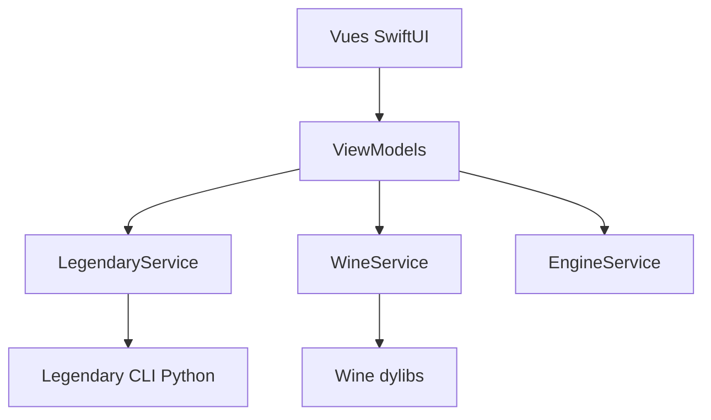

# MythicApp/Mythic

> Open-source game launcher for macOS that runs Windows games and manages Epic Games.

## The problem
On a Mac, playing Windows titles and managing your Epic library goes through several makeshift tools.

## What it actually does
A SwiftUI application that drives the Legendary CLI (embedded Python) for Epic authentication and downloads, plus Wine and a DirectX engine (DX9 to 12, 64-bit) to launch games, with manual imports, game management and Discord presence. Steam is not handled (on the roadmap).

## How it is wired

## Trying it
No documented command: download the application from the project page.

## Cost and gotchas
macOS 14 (Sonoma) minimum. Depends on Firebase (per the README list) and on Sparkle for updates; the actual use of Firebase is not explained.

## What it is not
Not a Steam client. The footer says "All rights reserved" while the catalog lists GPL-3.0: an unexplained contradiction.

## Alternatives
No alternative named in the README.

## For you
Ignore: a Mac gaming tool unrelated to data or AI, and the license needs clarifying.
