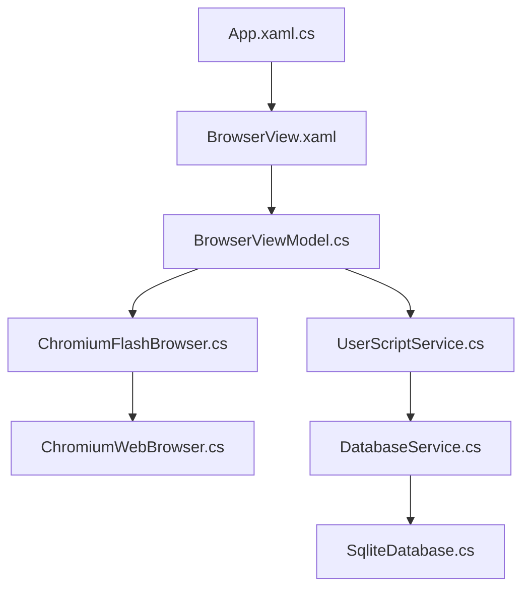

# Mzying2001/CefFlashBrowser

> Windows browser embedding Flash Player to open Flash content, SWF files and game saves.

## The problem
Flash is no longer supported by browsers, but pages, games and SWF files still exist.

## What it actually does
WPF application based on CefSharp, with the Flash plugin built in: it displays Flash pages, opens local SWFs and offers a save manager (SOL) to export, import and edit game files. A user-script service and a SQLite database store the data.

## How it is wired

## Trying it
The README gives no command: download the archive from Releases, unzip it and run `CefFlashBrowser.exe`.

## Cost and gotchas
Free. Requires .NET Framework 4.6.2; the `System.IO.FileNotFoundException` error indicates a missing Visual C++ Redistributable. Back up game files before any modification. The README is in Chinese and English.

## What it is not
Not a modern general-purpose browser. It is documented only for Windows and runs a Flash plugin, an abandoned technology.

## Alternatives
No alternative named in the README.

## For you
Ignore: Flash nostalgia tool for Windows, unrelated to data or MLOps.
