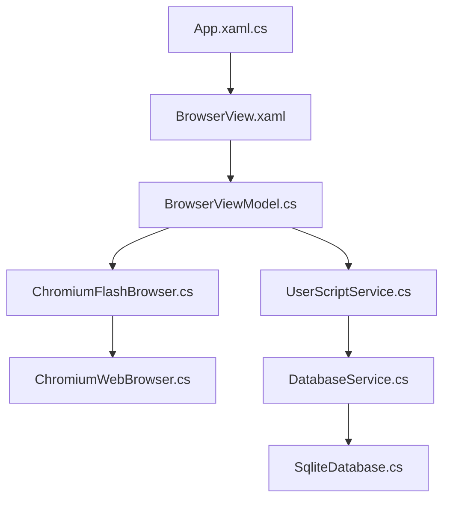

# Mzying2001/CefFlashBrowser

> Navigateur Windows embarquant Flash Player pour ouvrir contenus Flash, fichiers SWF et sauvegardes de jeux.

## Le problème
Flash n'est plus pris en charge par les navigateurs, mais des pages, jeux et fichiers SWF existent toujours.

## Ce que ça fait vraiment
Application WPF basée sur CefSharp, avec le plugin Flash intégré : elle affiche les pages Flash, ouvre des SWF locaux et propose un gestionnaire de sauvegardes (SOL) pour exporter, importer et modifier les fichiers de jeu. Un service de scripts utilisateur et une base SQLite stockent les données.

## Comment c'est branché

## Essayer
Le README ne donne pas de commande : télécharger l'archive depuis les Releases, la décompresser et lancer `CefFlashBrowser.exe`.

## Coût et pièges
Gratuit. Nécessite .NET Framework 4.6.2 ; l'erreur `System.IO.FileNotFoundException` indique un Visual C++ Redistributable manquant. Sauvegarde les fichiers de jeu avant toute modification. Le README est en chinois et en anglais.

## Ce que ce n'est pas
Ce n'est pas un navigateur généraliste moderne. Il n'est documenté que pour Windows et exécute un plugin Flash, technologie abandonnée.

## Alternatives
Aucune alternative nommée dans le README.

## Pour toi
À ignorer : outil de nostalgie Flash sous Windows, sans rapport avec la data ou le MLOps.

