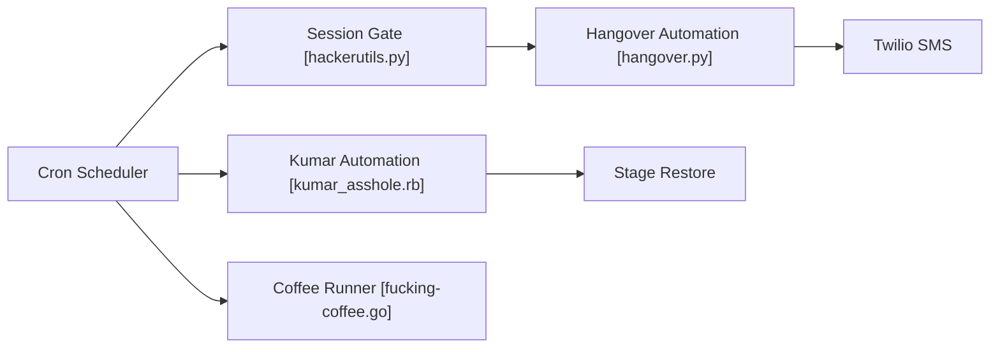

# NARKOZ/hacker-scripts

> Humorous automation scripts inspired by an anecdote: apology SMS, out-of-office emails, database rollback and coffee.

## The problem
No real problem; the repository illustrates automating boring tasks with cron, based on a developer's story.

## What it actually does
Four scripts launched by cron: a late-arrival SMS via Twilio if an SSH session is active in the evening, an out-of-office email at 8:45 when no session is open, a script that reads a Gmail inbox and restores a client's staging database based on keywords, and a script that orders a coffee machine over telnet. Implementations in Ruby, Python, Go and Node.js, as alternative variants.

## How it is wired


## Trying it
```bash
gem install dotenv twilio-ruby gmail
45 8 * * 1-5 /path/to/scripts/hangover.sh >> /path/to/hangover.log 2>&1
```
The other cron lines are in the README.

## Cost and gotchas
Twilio account (tokens at your expense) and Gmail credentials in environment variables, password in clear text. The restore script overwrites a database on a simple keyword in an email. The README claims the WTFPL, but the catalog detects no license: the catalog is authoritative.

## What it is not
It is not a maintained project (last push in 2023), nor a model to copy in a company: the messages sent deceive third parties.

## Alternatives
No alternative named in the README.

## For you
Ignore: entertainment with no clear license, no maintenance, and practices (clear-text passwords, deceptive messages) not to be reproduced.
