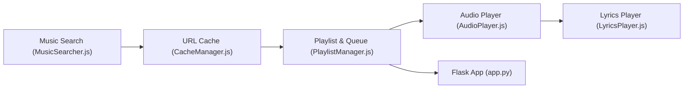

# NB-Group/NB_Music

> Electron music player that pulls audio from Bilibili, with synchronized lyrics, documented in Chinese.

## The problem
Listening to music from several platforms without a VIP subscription.

## What it actually does
Electron application: search through the Bilibili and NetEase APIs, import of Bilibili favorites as a playlist, playback with lyrics (NetEase or Bilibili subtitles), URL cache, local playlists. An optional Flask service handles login, playlists and matching. Developed by two middle-school students.

## How it is wired


## Trying it
```bash
yarn install
yarn debug
yarn run run
yarn build
```

## Cost and gotchas
Free, but depends on the Bilibili and NetEase APIs (the cited NetEase repository is "dead"). Hi-Res quality requires a Bilibili account with a high membership level. GPL-3.0 license with a commercial-use ban added in the README text, in tension with the GPL.

## What it is not
Not a licensed music source: the content comes from Bilibili. Announced commercial restrictions contradict the GPL.

## Alternatives
No alternative named in the README.

## For you
Ignore: a consumer music player unrelated to your field, and with an unclear legal status.
