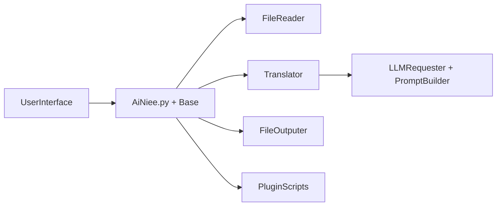

# NEKOparapa/AiNiee

> AI translation tool with a graphical interface for games, books, subtitles and long documents.

## The problem
Translating long texts (games, novels, subtitles) with an LLM loses consistency of names and style.

## What it actually does
You configure an API (or a local model via Ollama, LM Studio, Sakura), drop a folder, then start. Readers/writers for many formats (Mtool, Translator++, Renpy, Epub, Srt, Word, PDF…), AI glossary, no-translate table, text replacement, multi-key polling, plugins. The description also covers context and chain of thought.

## How it is wired

## Trying it
No documented command: the README describes three graphical steps (configure the interface, drag a folder, click start) and points to the downloads.

## Cost and gotchas
Online APIs are pay-per-use (the README mentions DeepSeek). AGPL-3.0 license. Communication mostly in Chinese.

## What it is not
Not a guaranteed offline translator; quality depends on the model. Use limited to legal and non-profit purposes according to the README.

## Alternatives
- AiNiee-Next: command-line version for servers.
- ainiee-translate-skill: agent-oriented novel translation system.

## For you
Worth watching: a good example of a batch LLM pipeline with a glossary, useful if you process long texts; language barrier.
