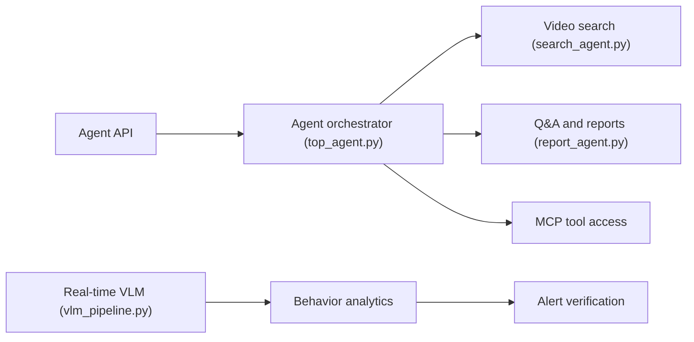

# NVIDIA-AI-Blueprints/video-search-and-summarization

> NVIDIA blueprint of GPU video agents: search, summarization, Q&A and alerts on streams or archives.

## The problem
Exploiting large volumes of video (stored or live) with VLMs/LLMs requires a full stack of ingestion, analytics and agents.

## What it actually does
Three layers: real-time video intelligence (embeddings, VLM, results published to a broker), downstream analytics (trajectories, incidents, VLM-verified alerts) and offline agents (search, Q&A, reports, long-video summarization, via MCP). Monorepo: Python agent, Next.js UI, analytics, Helm/Compose charts, skills.

## How it is wired

## Trying it
The README provided is truncated before the deployment commands. It only points to the notebook `deploy/docker/scripts/deploy_vss_launchable.ipynb` (Brev) and a Docker Compose deployment; no command is present.

## Cost and gotchas
NVIDIA AI Enterprise license to host the NIMs, or keys from the NVIDIA/NGC catalog. Strict prerequisites: 595.x drivers, Docker Engine between 28.3.3 and 29.5.0, NVIDIA Container Toolkit. Brev example: 2 x RTX PRO 6000 SE.

## What it is not
Not a lightweight library: it is a heavy reference architecture. The `develop-*` and `nightly-*` images are "AS IS"; video search is marked alpha.

## Alternatives
No alternative named in the README.

## For you
Keep an eye on it: relevant only with NVIDIA GPUs and a real video use case; otherwise the complexity and the license to check hold it back.
