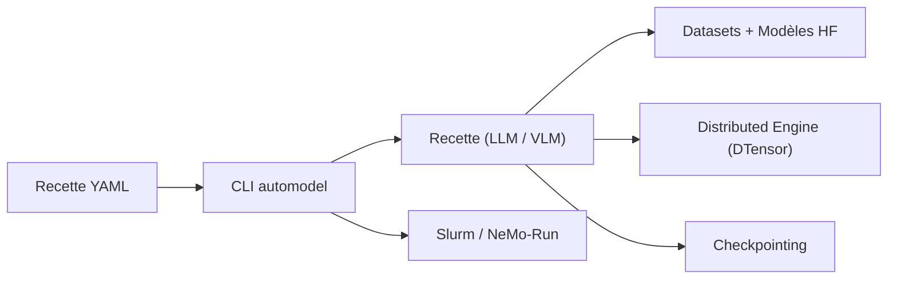

# NVIDIA-NeMo/Automodel

> PyTorch DTensor library for training and fine-tuning LLMs, VLMs, diffusion and retrieval at scale.

## The problem
Going from fine-tuning on one GPU to multi-node training forces you to rewrite models and parallelism strategy.

## What it actually does
`automodel` CLI (alias `am`) that launches YAML recipes overridable on the command line: pre-training, SFT, PEFT (LoRA, QLoRA), distillation, VLM, diffusion, retrieval. Hugging Face models without conversion, FSDP2, tensor and sequence parallelism, MoE via config, launch through Slurm, NeMo-Run or SkyPilot. README benchmarks: 250 TFLOPs/GPU on DeepSeek V3 671B with 256 GPUs.

## How it is wired


## Trying it
```bash
uv venv
uv sync --frozen
automodel examples/llm_finetune/llama3_2/llama3_2_1b_squad.yaml
automodel examples/llm_finetune/llama3_2/llama3_2_1b_squad.yaml --nproc-per-node 8
```

## Cost and gotchas
An NVIDIA GPU is essential, with CUDA extras (Transformer Engine, Mamba) depending on the recipes. The big benchmarks require clusters. 419 open issues.

## What it is not
Not an inference or serving tool. Optimized for NVIDIA hardware.

## Alternatives
The README cites Megatron Bridge (format conversions) and NeMo RL (DPO/GRPO post-training), as complements rather than replacements.

## For you
Worth watching: relevant if you fine-tune models on an NVIDIA cluster with reproducible recipes; overkill for a single GPU.
