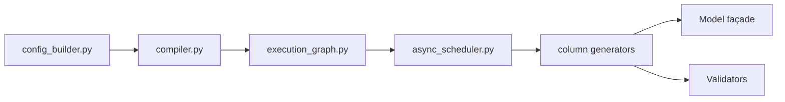

# NVIDIA-NeMo/DataDesigner

> Python library for generating validated synthetic datasets from LLMs, samplers or seeds.

## The problem
Asking an LLM for data produces rows with no distributions, no correlations and no quality control.

## What it actually does
You declare columns (samplers, LLM columns, images, expressions, embeddings) with dependencies; a compiler builds an execution graph and an asynchronous scheduler generates them with concurrency control. Python, SQL and remote validators, or an LLM judge, filter the output. MCP tools, plugins, preview, resume, Hugging Face publishing and OpenTelemetry export are provided.

## How it is wired


## Trying it
```bash
pip install data-designer
export NVIDIA_API_KEY="your-api-key-here"
data-designer config providers
data-designer config models
data-designer config list
```

## Cost and gotchas
NVIDIA Build, OpenAI or OpenRouter API key at your expense. NVIDIA Build is for evaluation only. Telemetry (model names, token counts), which can be disabled with `NEMO_TELEMETRY_ENABLED=false`.

## What it is not
Not a tool for anonymizing real data. Quality depends on the model and validators you choose.

## Alternatives
- No alternative named in the README.

## For you
Adopt for synthetic test or training datasets: a declarative, validated approach, with telemetry to disable.
