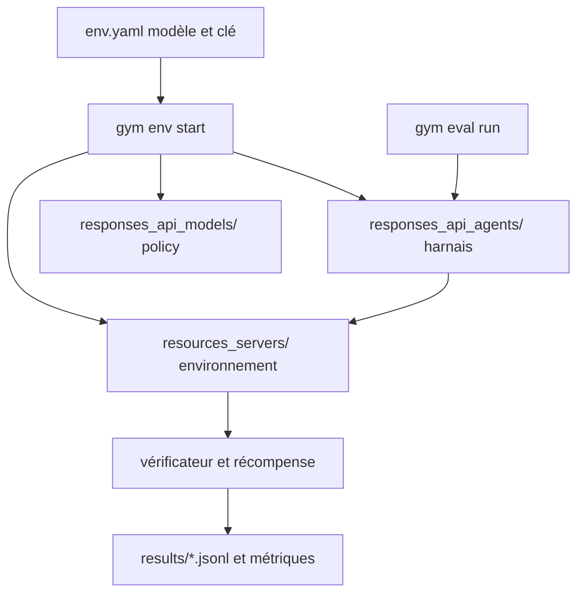

# NVIDIA-NeMo/Gym

> Library of environments to evaluate and train agents at scale.

## The problem
Evaluating an agent in a stateful environment — code execution, tool calls, sandbox — ends up as throwaway, non-reproducible scripts.
Moving from evaluation to reinforcement learning training forces you to rewrite everything.

## What it actually does
An environment brings together four things: a task set, an agent harness, a success verifier and a per-task execution state.
Three local servers coordinate model, agent and verification; `gym eval run` collects the rollouts and aggregates the metrics (`pass@1/accuracy`, mean reward).
Provides a catalog of environments with sample data, configuration and tests — SWE-bench and Terminal Bench driven by different harnesses, ARC-AGI, instruction following, abstention.
Combines with other environment libraries (Aviary, OpenEnv, Verifiers) and training frameworks (NeMo RL, Unsloth, VeRL).

## How it is wired


## Trying it
```bash
git clone https://github.com/NVIDIA-NeMo/Gym.git
cd Gym
uv venv --python 3.13.14 && source .venv/bin/activate
uv sync
gym env start --resources-server mcqa --model-type openai_model
gym eval run --no-serve --agent mcqa_simple_agent \
    --input resources_servers/mcqa/data/example.jsonl \
    --output results/mcqa_rollouts.jsonl --limit 5 --num-repeats 1
```

## Cost and gotchas
The quick start requires a funded OpenAI key; other providers are possible (Azure, self-hosted vLLM).
Python 3.13.14+ and `uv` are mandatory, 8 GB of RAM minimum, no GPU required for the library itself.
The official container omits `opencv-python-headless`, `torchvision` and `torchaudio`: reinstall them with `bash docker/install_codec_deps.sh` before any VLM or audio/video benchmark.

## What it is not
Not stable: the README announces moving APIs, incomplete documentation and bugs, and asks you to open an issue before any contribution.
Not useful for stateless verification: the README itself says a simple script is enough then.
Not a collection of ready-made datasets: many environments have no published data, only five sample tasks.

## Alternatives
- Aviary, OpenEnv, Reasoning Gym, Verifiers: other environment libraries, combinable rather than competing.
- NeMo RL, Unsloth, VeRL: on the training side, if the need is RL and not the environment.

## For you
The right framework if you must measure an agent reproducibly; keep it away from production as long as the APIs keep moving.
