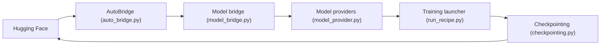

# NVIDIA-NeMo/Megatron-Bridge

> NVIDIA library that converts Hugging Face models to Megatron Core, to train or fine-tune them.

## The problem
Hugging Face models do not directly benefit from Megatron Core's parallelism, and checkpoints from the two worlds are not interchangeable.

## What it actually does
Converts in both directions (HF ↔ Megatron) via `AutoBridge`, taking parallelism into account and streaming parameter by parameter. It also provides a PyTorch training loop with recipes for pre-training, SFT and LoRA/DoRA (FP8, BF16, FP4). The graph adds inference, diffusion (FLUX, WAN) and PEFT conversion.

## How it is wired


## Trying it
```bash
docker run --rm -it -w /workdir -v $(pwd):/workdir \
  --entrypoint bash \
  --gpus all \
  nvcr.io/nvidia/nemo:${TAG}
huggingface-cli login --token <your token>
uv run python -m torch.distributed.run --nproc-per-node=<num devices> /path/to/script.py
```

## Cost and gotchas
GPU required, NeMo container recommended for full functionality; Megatron-Core is a pinned submodule (`switch_mcore.sh` main/dev, `uv sync` must be re-run). A Hugging Face account is needed for gated models.

## What it is not
Not a lightweight tool for a machine without a GPU. Megatron-Core's dev branch is experimental. 472 open issues: the project moves fast.

## Alternatives
No alternative named in the README.

## For you
Worth watching: useful if you train or fine-tune at large scale on NVIDIA GPUs with Megatron, pointless for inference or modest fine-tuning.
