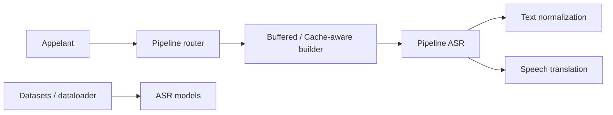

# NVIDIA-NeMo/NeMo

> PyTorch toolkit to build, adapt and deploy speech models (ASR, TTS, Speech LLM).

## The problem
Training or adapting a speech recognition or synthesis model means stitching together data, architectures and deployment.

## What it actually does
Library for researchers and PyTorch developers: speech recognition (including a streaming, buffered or cache-aware pipeline), synthesis (Magpie TTS), audio transformation, a real-time voice agent over WebSocket, data loading and training objectives. It offers pre-trained checkpoints on Hugging Face. The repository is presented under the name NeMo Speech.

## How it is wired


## Trying it
```bash
git clone https://github.com/NVIDIA-NeMo/Speech.git
cd Speech
uv sync --extra all --extra cu13
```
```bash
uv pip install 'nemo-toolkit[asr,tts]'
```

## Cost and gotchas
NVIDIA GPU + CUDA required for training, recommended for inference. Python 3.12+, PyTorch 2.7+. Do not use `uv sync --locked` on an existing environment: it replaces your stack. `TORCH_FORCE_NO_WEIGHTS_ONLY_LOAD=1` only for trusted files.

## What it is not
Not a turnkey service. The diagram mostly samples streaming ASR only; the wiring of the other subsystems is not established.

## Alternatives
No alternative named in the README.

## For you
Adopt it if you do speech on NVIDIA GPUs: a steady publisher, open checkpoints and a reproducible stack via `uv.lock`.
