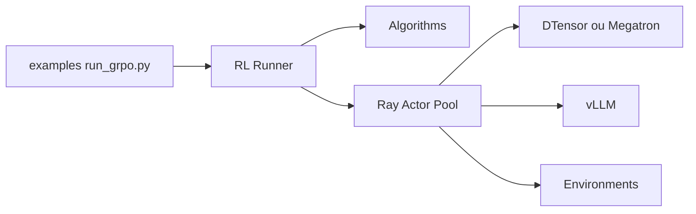

# NVIDIA-NeMo/RL

> Reinforcement learning post-training library for LLMs and VLMs, from prototype to multi-node.

## The problem
Aligning and fine-tuning models (GRPO, DPO, distillation) at scale requires orchestrating training, generation and reward environments.

## What it actually does
On Ray, the orchestrator links algorithms (GRPO/GSPO/DAPO, SFT with LoRA, DPO, reward model, on-policy and cross-tokenizer distillation), data, environments (math, games, VLM) and training backends (DTensor or Megatron Core) as well as generation backends (vLLM, Megatron, SGLang). Multi-turn rollouts and asynchronous RL. Launch locally, on Slurm or Kubernetes.

## How it is wired


## Trying it
```bash
git clone git@github.com:NVIDIA-NeMo/RL.git nemo-rl --recursive
cd nemo-rl
uv venv
uv run python examples/run_grpo.py
uv run examples/run_grpo.py --config examples/configs/grpo_smoke.yaml
```

## Cost and gotchas
NVIDIA GPU, NGC container recommended (`nvcr.io/nvidia/nemo-rl:latest`), Hugging Face token for gated models, Weights & Biases optional. Git submodules mandatory; 1,125 open issues.

## What it is not
Not a tool to try without a GPU: CPU mode is not documented for RL. The "v0.7" features are announced, not delivered.

## Alternatives
No alternative named in the README.

## For you
Worth watching: a useful reference for LLM RL post-training if you have GPUs; otherwise too heavy to install.
