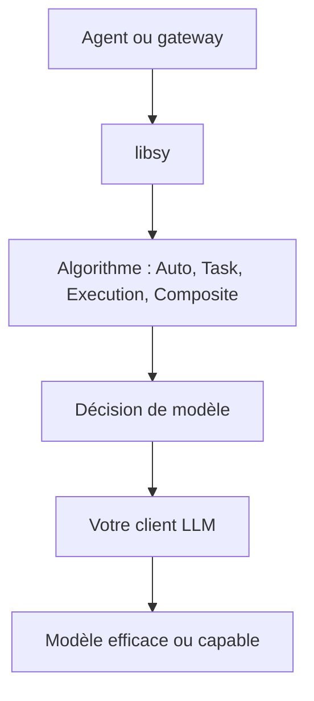

# NVIDIA-NeMo/Switchyard

> Rust library that chooses, request by request, which model serves an AI agent, to balance cost and success.

## The problem
An agent that sends everything to the biggest model is expensive; if it sends everything to the small one, it fails. A per-request routing decision is missing.

## What it actually does
The libsy core examines the request or the agent's recent tool activity, then designates the model. Several algorithms: Auto (Execution/Stage, efficient first), Task (a model judges the task), Execution, Composite. You keep the model clients, the keys and the service; Switchyard only provides the decision.

## How it is wired
Simplified diagram based on the sheet, no diagram provided.

## Trying it
No installation command is documented in this README. Described routes: go through OpenRouter by setting `model` to `nvidia/switchyard`, the LiteLLM plugin example, the native NeMo Relay plugin, or integrate libsy in Rust (`Algorithm::run_stream`).

## Cost and gotchas
Model calls are at your expense, plus those of any judge model. A cheaper call does not guarantee a cheaper task: compare against your single-model baseline. Pre-1.0, unstable API.

## What it is not
Not a production server: the standalone server is reserved for demos. Not an LLM client. Some settings disable routing without an error.

## Alternatives
OpenRouter (hosted routing); LiteLLM (gateway, experimental integration).

## For you
Worth watching: the idea of cost/quality routing matters for an MLOps profile, but the API moves before 1.0.
