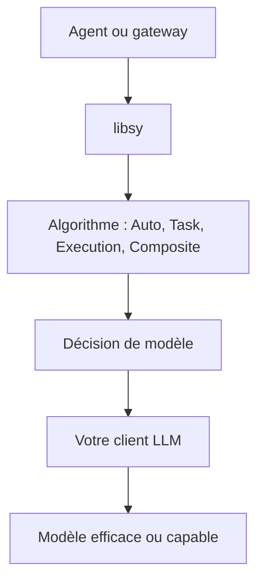

# NVIDIA-NeMo/Switchyard

> Bibliothèque Rust qui choisit, requête par requête, quel modèle sert un agent IA, pour équilibrer coût et réussite.

## Le problème
Un agent qui envoie tout au plus gros modèle coûte cher ; s'il envoie tout au petit, il échoue. Il manque une décision de routage par requête.

## Ce que ça fait vraiment
Le cœur libsy examine la requête ou l'activité récente des outils de l'agent, puis désigne le modèle. Plusieurs algorithmes : Auto (Execution/Stage, efficace d'abord), Task (un modèle juge la tâche), Execution, Composite. Vous gardez les clients de modèles, les clés et le service ; Switchyard ne fournit que la décision.

## Comment c'est branché
Schéma simplifié d'après la fiche, sans diagramme fourni.

## Essayer
Aucune commande d'installation n'est documentée dans ce README. Voies décrites : passer par OpenRouter en réglant `model` sur `nvidia/switchyard`, l'exemple de plugin LiteLLM, le plugin natif NeMo Relay, ou intégrer libsy en Rust (`Algorithm::run_stream`).

## Coût et pièges
Les appels de modèles sont à votre charge, plus ceux d'un éventuel modèle juge. Un appel moins cher ne garantit pas une tâche moins chère : comparez à votre référence mono-modèle. Pré-1.0, API instable.

## Ce que ce n'est pas
Pas un serveur de production : le serveur autonome est réservé aux démos. Pas un client LLM. Certains réglages désactivent le routage sans erreur.

## Alternatives
OpenRouter (routage hébergé) ; LiteLLM (passerelle, intégration expérimentale).

## Pour toi
À surveiller : l'idée de routage coût/qualité compte pour un MLOps, mais l'API bouge avant la 1.0.

