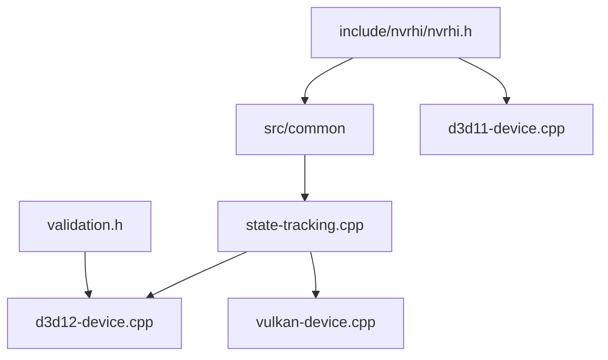

# NVIDIA-RTX/NVRHI

> C++ abstraction layer on top of D3D11, D3D12 and Vulkan for rendering engines.

## The problem
Writing a rendering engine for several graphics APIs forces you to duplicate barriers, resource states and bindings.

## What it actually does
Offers a common interface (devices, command lists, buffers, textures, graphics pipelines, compute, ray tracing, meshlets) with automatic state tracking, deferred destruction, upload buffer sub-allocation and a validation layer. Three backends and optional RTXMU and NVAPI integration.

## How it is wired


## Trying it
```bash
# Add as a CMake submodule: add_subdirectory(nvrhi)
# Shared library: NVRHI_BUILD_SHARED=ON
```

## Cost and gotchas
C++17 compiler, CMake 3.10, Windows SDK 10.0.22621.0 for DX12. 32-bit builds are not supported.

## What it is not
Not a game engine nor an AI compute library: it is low-level graphics abstraction.

## Alternatives
No alternative named in the README.

## For you
Ignore: useful to rendering engine developers, not to a data/MLOps profile.
