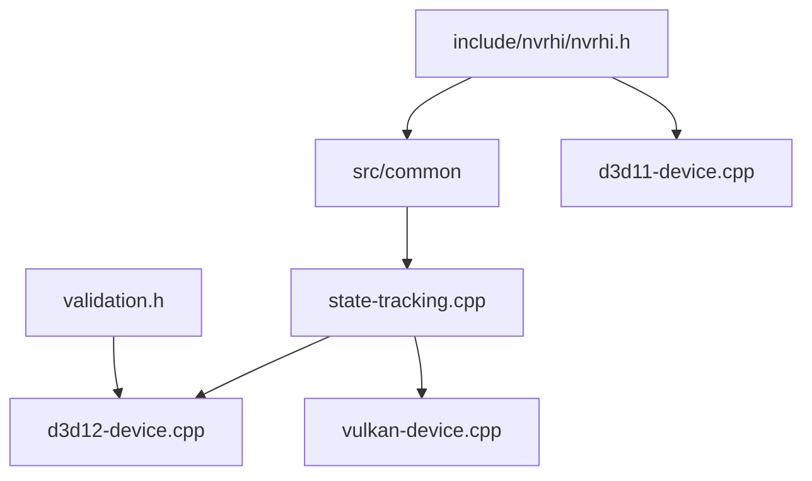

# NVIDIA-RTX/NVRHI

> Couche d'abstraction C++ au-dessus de D3D11, D3D12 et Vulkan pour moteurs de rendu.

## Le problème
Écrire un moteur de rendu pour plusieurs API graphiques oblige à dupliquer barrières, états de ressources et liaisons.

## Ce que ça fait vraiment
Offre une interface commune (périphériques, listes de commandes, buffers, textures, pipelines graphique, calcul, ray tracing, meshlets) avec suivi automatique des états, destruction différée, sous-allocation des buffers d'upload et couche de validation. Trois backends et une intégration optionnelle de RTXMU et NVAPI.

## Comment c'est branché


## Essayer
```bash
# Ajout comme sous-module CMake : add_subdirectory(nvrhi)
# Bibliothèque partagée : NVRHI_BUILD_SHARED=ON
```

## Coût et pièges
Compilateur C++17, CMake 3.10, Windows SDK 10.0.22621.0 pour DX12. Les builds 32 bits ne sont pas pris en charge.

## Ce que ce n'est pas
Pas un moteur de jeu ni une bibliothèque de calcul IA : c'est de l'abstraction graphique bas niveau.

## Alternatives
Aucune alternative nommée dans le README.

## Pour toi
Ignorer : utile aux développeurs de moteurs de rendu, pas à un profil data/MLOps.

