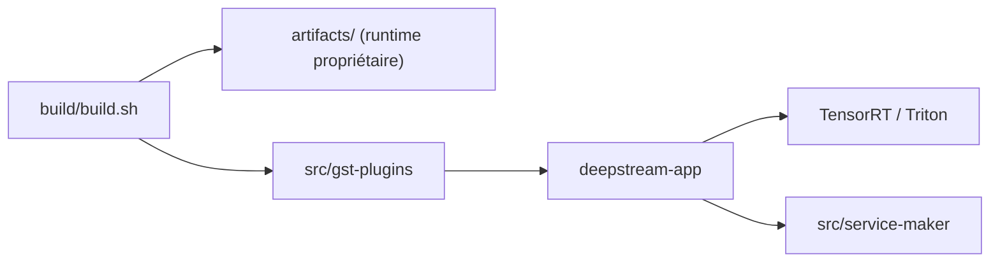

# NVIDIA/DeepStream

> NVIDIA toolkit for multi-stream video pipelines on GStreamer and TensorRT, for vision engineers on GPU.

## The problem
Analyzing several video streams in real time with several models requires assembling hardware decoding, inference, tracking and messaging.

## What it actually does
Unified repository of the DeepStream 9.2 SDK: GStreamer plugins, sample and reference apps, Service Maker C++/Python, tools (inference_builder, auto-magic-calib, yolo_deepstream, SAM2 to TensorRT) and skills for coding agents. The proprietary libraries come from the release assets, downloaded by the build script.

## How it is wired
Simplified diagram based on the sheet, no diagram provided.


## Trying it
```bash
sudo apt-get install git-lfs && git lfs install
git clone --recurse-submodules https://github.com/NVIDIA/DeepStream.git && cd DeepStream
bash build/build.sh
cd /opt/nvidia/deepstream/deepstream-9.2/samples/configs/deepstream-app
deepstream-app -c source30_1080p_dec_infer-resnet_tiled_display.txt
```

## Cost and gotchas
NVIDIA GPU (or Jetson), driver 595+, CUDA 13.2, Ubuntu 24.04. Part of the runtime is proprietary and the actual license needs checking (code Apache-2.0, docs CC-BY-4.0 according to the README, submodule under an NVIDIA license).

## What it is not
It is not a standalone tool: without an NVIDIA GPU, nothing runs. SBSA/DGX Spark requires the Docker container. It cannot be fully built from free sources.

## Alternatives
No alternative named in the README.

## For you
Keep an eye on it: an industry reference for video on NVIDIA GPUs, only useful if you deploy video inference in production on this hardware.
