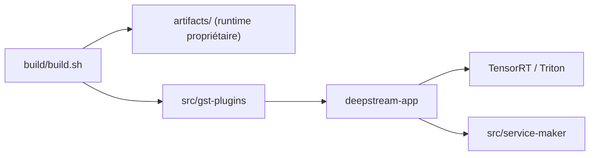

# NVIDIA/DeepStream

> Kit NVIDIA de pipelines vidéo multi-flux sur GStreamer et TensorRT, pour ingénieurs vision sur GPU.

## Le problème
Analyser plusieurs flux vidéo en temps réel avec plusieurs modèles exige d'assembler décodage matériel, inférence, suivi et messagerie.

## Ce que ça fait vraiment
Dépôt unifié du SDK DeepStream 9.2 : plugins GStreamer, apps d'exemple et de référence, Service Maker C++/Python, outils (inference_builder, auto-magic-calib, yolo_deepstream, SAM2 vers TensorRT) et des skills pour agents de code. Les bibliothèques propriétaires viennent des assets de release, téléchargés par le script de build.

## Comment c'est branché
Schéma simplifié d'après la fiche, sans diagramme fourni.


## Essayer
```bash
sudo apt-get install git-lfs && git lfs install
git clone --recurse-submodules https://github.com/NVIDIA/DeepStream.git && cd DeepStream
bash build/build.sh
cd /opt/nvidia/deepstream/deepstream-9.2/samples/configs/deepstream-app
deepstream-app -c source30_1080p_dec_infer-resnet_tiled_display.txt
```

## Coût et pièges
GPU NVIDIA (ou Jetson), pilote 595+, CUDA 13.2, Ubuntu 24.04. Une partie du runtime est propriétaire et la licence réelle est à vérifier (code Apache-2.0, doc CC-BY-4.0 selon le README, sous-module sous licence NVIDIA).

## Ce que ce n'est pas
Ce n'est pas un outil autonome : sans GPU NVIDIA, rien ne tourne. Le SBSA/DGX Spark exige le conteneur Docker. Il ne se compile pas entièrement depuis les sources libres.

## Alternatives
Aucune alternative nommée dans le README.

## Pour toi
À surveiller : référence industrielle pour la vidéo sur GPU NVIDIA, utile seulement si tu déploies de l'inférence vidéo en production sur ce matériel.

