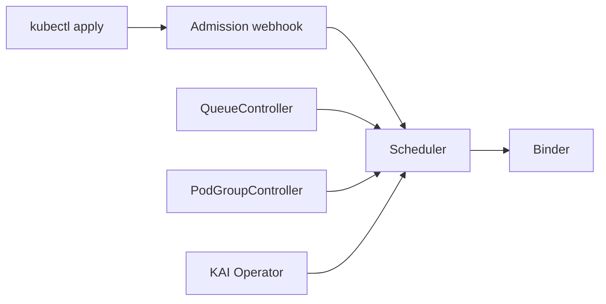

# NVIDIA/KAI-Scheduler

> Kubernetes scheduler that distributes GPUs across AI workloads, for administrators of large clusters.

## The problem
The standard Kubernetes scheduler shares expensive GPUs poorly between teams: fragmentation, queues, no fairness.

## What it actually does
Gang scheduling, bin-packing or spreading, hierarchical queues with quotas and fairness (DRF, usage history), preemption, consolidation, elastic workloads, GPU sharing, DRA and topology-aware placement. It coexists with other schedulers. Built from kube-batch.

## How it is wired


## Trying it
```bash
helm upgrade -i kai-scheduler oci://ghcr.io/kai-scheduler/kai-scheduler/kai-scheduler -n kai-scheduler --create-namespace --version <VERSION>
```

## Cost and gotchas
Requires a Kubernetes cluster, Helm and the NVIDIA GPU Operator. Do not submit workloads in the `kai-scheduler` namespace. Specific settings for OpenShift.

## What it is not
Not a tool for a single machine or a small cluster: the value appears with many shared GPUs. It is not a training engine.

## Alternatives
- kube-batch: the base KAI comes from, simpler if you only need gang scheduling.

## For you
Worth watching: relevant in MLOps on a shared GPU cluster; otherwise useless, and the license is not declared in the catalog.
