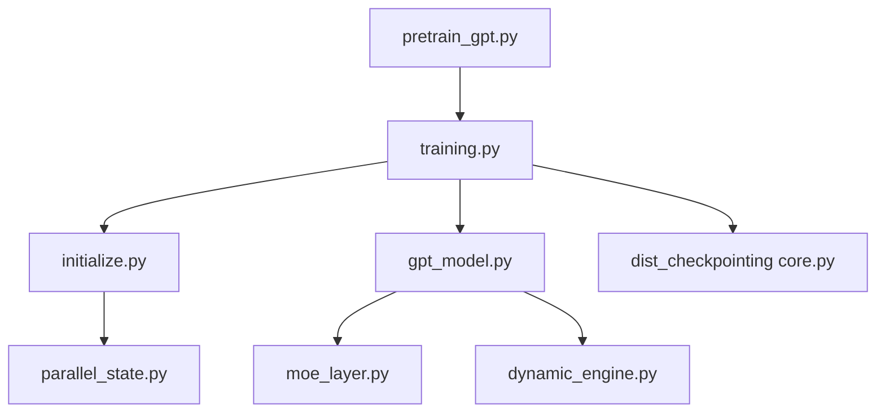

# NVIDIA/Megatron-LM

> NVIDIA library for training transformers at scale on GPU clusters.

## The problem
Training a model with billions of parameters requires splitting compute, memory and states across hundreds of GPUs. PyTorch alone does not offer these building blocks.

## What it actually does
Megatron Core provides transformer blocks, MoE and the TP, PP, DP, EP and CP parallelisms, with FP16, BF16, FP8 and FP4.
Megatron-LM adds reference training scripts (`pretrain_gpt.py`, `train_rl.py`).
Distributed checkpoints and resharding, a dynamic inference engine with an OpenAI-style server, export to TensorRT-LLM.
The README cites 47% MFU on H100s; the measurement is taken without running to convergence.

## How it is wired


## Trying it
```bash
uv pip install megatron-core
git clone https://github.com/NVIDIA/Megatron-LM.git
cd Megatron-LM
uv pip install -e .
MAX_JOBS=4 uv pip install -e .
```

## Cost and gotchas
NVIDIA GPUs are required, and the real benefit only comes with multiple nodes. Building from source uses a lot of memory.

## What it is not
Not a lightweight fine-tuning tool for a single card. Not a mainstream serving engine: inference is secondary. GitHub does not identify the license.

## Alternatives
The README names no competing repository. It only points to Megatron Bridge for conversion to and from Hugging Face.

## For you
Worth watching: it is the reference for distributed pre-training, but without a GPU cluster you get nothing from it day to day.
