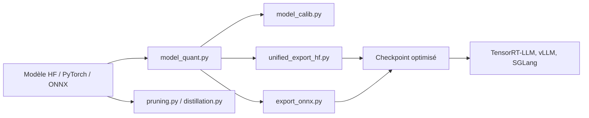

# NVIDIA/Model-Optimizer

> NVIDIA Python library to quantize, prune, distill and export models for inference.

## The problem
A full-precision LLM or diffusion model is expensive in memory and latency; chaining quantization, calibration and export to the inference engine yourself is tedious.

## What it actually does
Takes a Hugging Face, PyTorch or ONNX model and applies, via composable Python APIs: post-training quantization (size divided by 2 to 4 according to the README), QAT, pruning, NAS, distillation, speculative decoding, sparsity.
Calibration, quantized layers, ONNX autocast; unified export to Hugging Face (transformers and diffusers), ONNX, TensorRT-LLM.
Checkpoints for SGLang, TensorRT-LLM, TensorRT or vLLM; a collection of pre-quantized checkpoints on Hugging Face.
Hooked into Megatron-Bridge, Megatron-LM and HF Accelerate; skills provided for Claude Code and Codex.

## How it is wired


## Trying it
```bash
pip install -U nvidia-modelopt[all]
git clone git@github.com:NVIDIA/Model-Optimizer.git
cd Model-Optimizer
pip install -e .[dev]
claude plugin marketplace add https://github.com/NVIDIA/Model-Optimizer.git
claude plugin install modelopt@modelopt
```

## Cost and gotchas
Free, but designed for the NVIDIA ecosystem: GPU and `nvcr.io` containers with their own licenses. Installation pulls in third-party software whose licenses the README asks you to review.

## What it is not
Not an inference engine: it produces the checkpoint, serving is left to vLLM, SGLang or TensorRT-LLM.
Not stable: version 0.x, deprecated features removed after one release (~1 month), breaking changes possible in a minor version.

## Alternatives
No alternative named in the README.

## For you
Adopt if you serve LLMs on NVIDIA GPUs with vLLM or TensorRT-LLM; pin the version.
