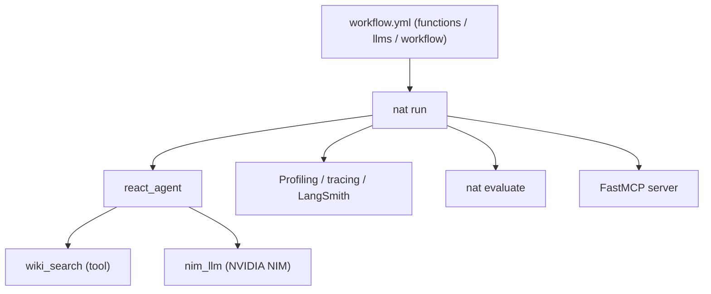

# NVIDIA/NeMo-Agent-Toolkit

> Instrumentation, observability and optimization layer to place on top of agents that are already written.

## The problem
An agent in production is a black box: you do not know where the tokens go, why a step drags, or whether a change improved anything.

## What it actually does
Plugs in next to the existing framework (LangChain, LlamaIndex, CrewAI, Semantic Kernel, Google ADK, or plain Python) to profile the workflow from the agent level down to the token, trace execution and evaluate offline. Adds a hyperparameter and prompt optimizer, reinforcement fine-tuning, a native LangSmith integration, publishing a workflow as an MCP server via FastMCP, and "Agent Performance Primitives" (parallel execution, speculative branching, priority routing). Workflows are declared in YAML.

## How it is wired


## Trying it
```bash
pip install nvidia-nat
pip install "nvidia-nat[langchain]"
export NVIDIA_API_KEY=<your_api_key>
nat run --config_file workflow.yml --input "List five subspecies of Aardvarks"
nat configure telemetry --status
```

## Cost and gotchas
Python 3.11 to 3.13. The "Hello World" example requires an `NVIDIA_API_KEY` obtained by creating an account on build.nvidia.com. Telemetry: on the first interactive `nat` a prompt offers to send events and **accepts by default** if you press Enter; in a non-interactive context it is disabled unless `NAT_TELEMETRY_ENABLED=true`. The README details what is sent (command name, outcome, duration, exit code, Python version) and what is not.

## What it is not
Not yet another agent framework: it does not replace LangChain or CrewAI, it instruments them. Several flagship components are marked experimental (Dynamo, runtime intelligence). Version 1.5.0 changed the installation: migration required.

## Alternatives
- LangSmith alone, if you only want tracing and evaluation experiments.
- The frameworks cited (LangChain, CrewAI, Agno) if you want to write the agent, not measure it.

## For you
Worth a look if you already have agents in production and the topic is measurement, not authoring.
