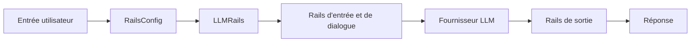

# NVIDIA/NeMo-Guardrails

> Adds programmable guardrails between an application and its LLM, for chatbot and RAG developers.

## The problem
An LLM in production can go off topic, leak data or give in to prompt injections without any control.

## What it actually does
Five types of rails: input, dialogue, retrieval, execution, output. Dialogue is described in Colang (1.0 by default, 2.0 available), configuration in `config.yml`, `rails.co` and `actions.py`. Checks for jailbreak, facts, hallucination, masking of sensitive data. Async-first Python API, CLI and HTTP server, optional LangChain integration.

## How it is wired


## Trying it
```bash
pip install nemoguardrails
nemoguardrails server [--config PATH/TO/CONFIGS] [--port PORT]
```
```python
from nemoguardrails import LLMRails, RailsConfig
rails = LLMRails(RailsConfig.from_path("PATH/TO/CONFIG"))
```

## Cost and gotchas
LLM calls remain at your expense (provider key). Anonymous telemetry is enabled: set `DO_NOT_TRACK=1` before startup to turn it off. NVIDIA Build is for evaluation only.

## What it is not
The built-in rails may not fit your case: the README asks you to validate them. It is not a guarantee of total security.

## Alternatives
- guardrails.ai: control by analyzing the output, cited by the README.
- LLM-Guard: individual guardrails, to combine rather than replace.

## For you
Adopt: mature framework for framing a chatbot or RAG, provided you turn off telemetry and check the license.
