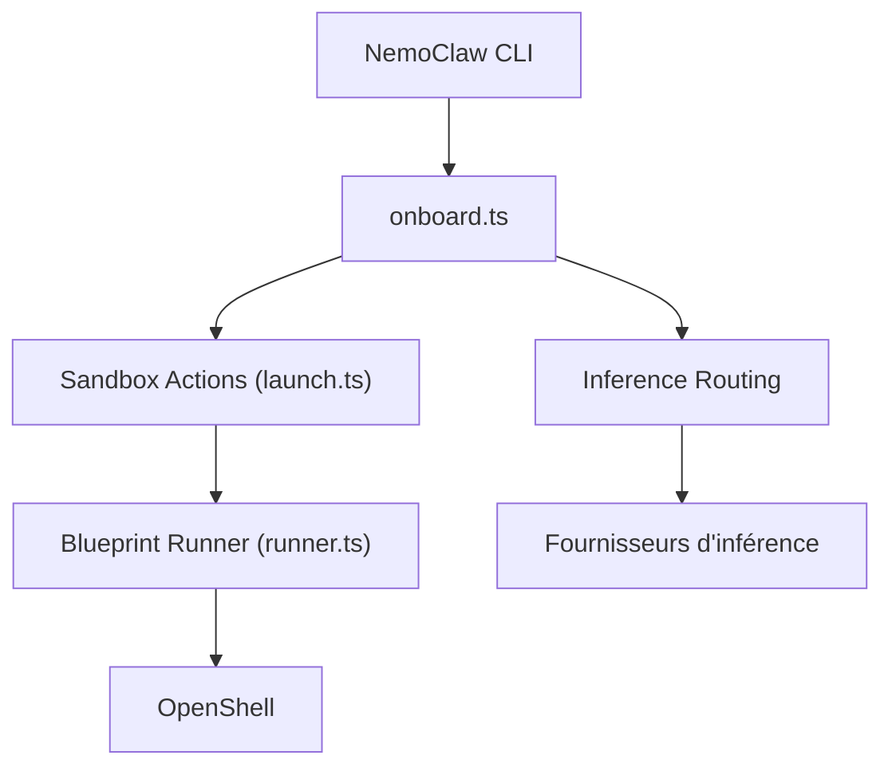

# NVIDIA/NemoClaw

> NVIDIA reference stack for running AI agents in OpenShell sandboxes.

## The problem
An agent that acts on your machine needs isolation, a network policy and controlled inference.

## What it actually does
A CLI guides the installation, chooses the agent (OpenClaw by default, Hermes, LangChain Deep Agents Code) and the inference provider, applies a network policy and launches the OpenShell sandbox. From the code: rebuild pipeline, snapshots, messaging integrations, MCP and voice sessions. The other subsystems are only partially confirmed.

## How it is wired


## Trying it
```bash
# Aucune commande documentée dans ce README : installeur terminal (invite « Run express install ») et pages Quickstart des docs.
```

## Cost and gotchas
Inference via a provider at your expense; DGX or WSL host for express mode. Detailed hardware requirements are in the docs, not in this README. The software fetches external resources under their own licenses.

## What it is not
Not an agent in itself, but a runtime stack around existing agents. "Safer" does not mean guaranteed: the README avoids any security promise.

## Alternatives
OpenShell alone: the README says when to use it without NemoClaw.

## For you
Worth watching: useful if you need to isolate agents with an explicit network policy; young (2026-03) and dependent on the NVIDIA ecosystem.
