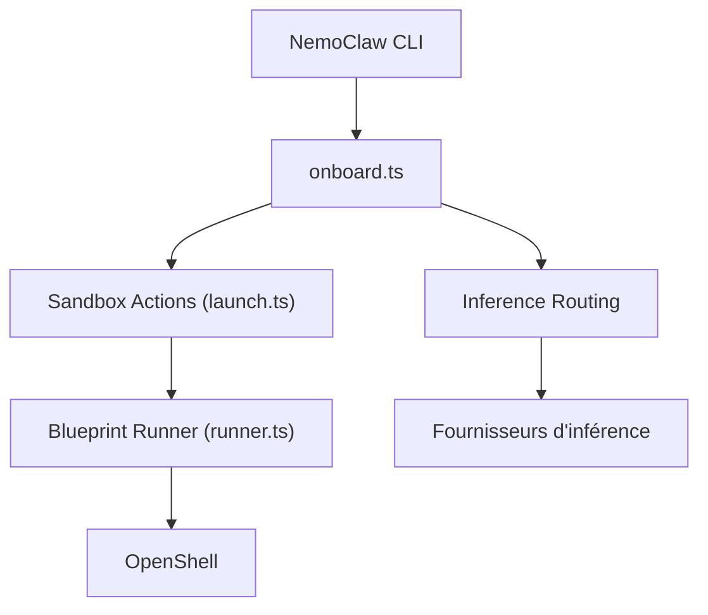

# NVIDIA/NemoClaw

> Pile de référence NVIDIA pour faire tourner des agents IA dans des bacs à sable OpenShell.

## Le problème
Un agent qui agit sur ta machine a besoin d'isolation, de politique réseau et d'une inférence cadrée.

## Ce que ça fait vraiment
Une CLI guide l'installation, choisit l'agent (OpenClaw par défaut, Hermes, LangChain Deep Agents Code) et le fournisseur d'inférence, applique une politique réseau et lance le sandbox OpenShell. D'après le code : pipeline de reconstruction, snapshots, intégrations de messagerie, MCP et sessions vocales. Les autres sous-systèmes ne sont confirmés que partiellement.

## Comment c'est branché


## Essayer
```bash
# Aucune commande documentée dans ce README : installeur terminal (invite « Run express install ») et pages Quickstart des docs.
```

## Coût et pièges
Inférence via un fournisseur à ta charge ; hôte DGX ou WSL pour le mode express. Prérequis matériels détaillés dans les docs, non dans ce README. Le logiciel récupère des ressources externes sous leurs propres licences.

## Ce que ce n'est pas
Pas un agent en soi, mais une pile d'exécution autour d'agents existants. « Plus sûr » ne veut pas dire garanti : le README évite toute promesse de sécurité.

## Alternatives
OpenShell seul : le README dit quand l'utiliser sans NemoClaw.

## Pour toi
À surveiller : utile si tu dois isoler des agents avec politique réseau explicite ; jeune (2026-03) et dépendant de l'écosystème NVIDIA.

