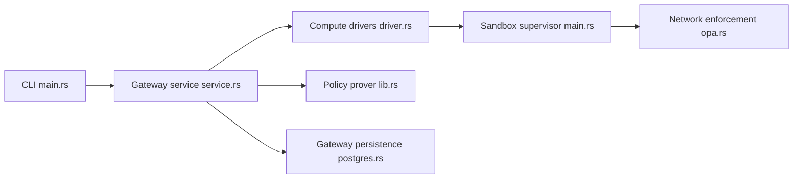

# NVIDIA/OpenShell

> Sandboxed execution of AI agents with file, system-call and network policies.

## The problem
To be useful, agents must read files, install packages and use credentials, without free access to data and secrets.

## What it actually does
A CLI and a gateway create sandboxes (Docker, Podman or virtualization) where kernel controls limit files and system calls, while every network connection goes through a policy check. Real credentials are only injected towards approved endpoints. A formal verifier flags risky policy changes before human approval. Python, TypeScript, Go and Rust SDKs; Kubernetes deployment with Helm.

## How it is wired


## Trying it
```bash
curl -LsSf https://raw.githubusercontent.com/NVIDIA/OpenShell/main/install.sh | sh
openshell sandbox create --name demo
npx skills add NVIDIA/OpenShell
```

## Cost and gotchas
Linux, macOS Apple Silicon or Windows WSL 2 (experimental), plus Docker, Podman or virtualization. The Kubernetes CNI must enforce `NetworkPolicy`. Anonymous telemetry is on (can be disabled with `OPENSHELL_TELEMETRY_ENABLED=false`).

## What it is not
The default image is a minimal Ubuntu with no agent installed. The README states that the software fetches external materials for which you remain responsible.

## Alternatives
No alternative named in the README.

## For you
Adopt: if you have agents run code on sensitive data, a sandbox with declarative policies is the missing building block; try it locally first.
