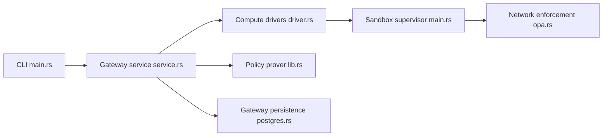

# NVIDIA/OpenShell

> Exécution cloisonnée d'agents IA avec politiques de fichiers, appels système et réseau.

## Le problème
Pour être utiles, les agents doivent lire des fichiers, installer des paquets et utiliser des identifiants, sans accès libre aux données et aux secrets.

## Ce que ça fait vraiment
Un CLI et une passerelle créent des bacs à sable (Docker, Podman ou virtualisation) où des contrôles noyau limitent fichiers et appels système, tandis que chaque connexion réseau passe par une vérification de politique. Les identifiants réels ne sont injectés que vers des points de terminaison approuvés. Un vérificateur formel signale les changements de politique risqués avant approbation humaine. SDK Python, TypeScript, Go et Rust ; déploiement Kubernetes avec Helm.

## Comment c'est branché


## Essayer
```bash
curl -LsSf https://raw.githubusercontent.com/NVIDIA/OpenShell/main/install.sh | sh
openshell sandbox create --name demo
npx skills add NVIDIA/OpenShell
```

## Coût et pièges
Linux, macOS Apple Silicon ou Windows WSL 2 (expérimental), plus Docker, Podman ou virtualisation. Le CNI Kubernetes doit appliquer `NetworkPolicy`. Télémétrie anonyme active (désactivable par `OPENSHELL_TELEMETRY_ENABLED=false`).

## Ce que ce n'est pas
L'image par défaut est un Ubuntu minimal sans agent installé. Le README précise que le logiciel récupère des matériaux externes dont tu restes responsable.

## Alternatives
Aucune alternative nommée dans le README.

## Pour toi
À adopter : si tu fais exécuter du code à des agents sur des données sensibles, un bac à sable à politiques déclaratives est la brique qui manque ; teste-le d'abord en local.

