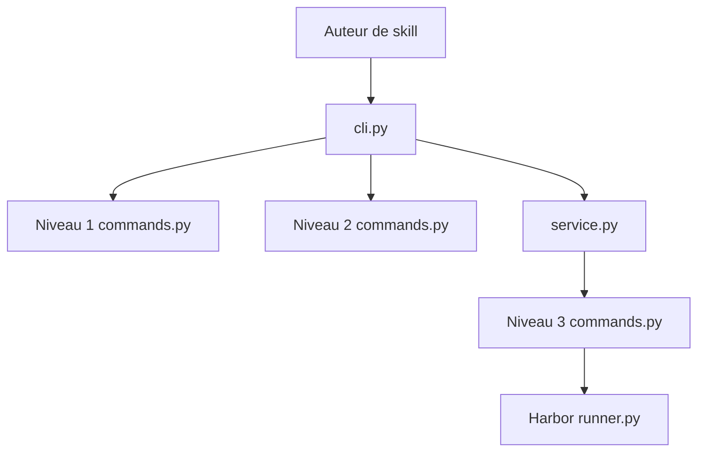

# NVIDIA/SkillEvaluator

> Open-source tool that checks the quality of AI agent skills and measures their effect on tasks.

## The problem
An agent skill can be badly written, dangerous or useless, and nothing shows it before trying it for real.

## What it actually does
- Tier 1: static validation, with a score and security analysis (SkillSpector, Gitleaks).
- Tier 2: detection of duplicates and overlapping instructions via embeddings.
- Tier 3: real execution with and without the skill, via Harbor and a Docker sandbox.
- HTML reports and continuous integration templates for GitHub and GitLab.

## How it is wired


## Trying it
```bash
pip install --upgrade skillevaluator
skillevaluator ci init
uv run --python 3.13 skillevaluator quality-check src/skillevaluator/tier3/reference_skills/text-analyzer -r cli -r json -o reports/first-quality
```

## Cost and gotchas
The basic quality check needs neither a key nor a GPU. The tiers using a model need an NVIDIA Build key or a provider, and tier 3 a Docker sandbox; model usage may be billed.

## What it is not
Not a model benchmark: it evaluates skills. A static score does not prove the effect on the agent; publication evidence remains incomplete without tier 3.

## Alternatives
No alternative named in the README.

## For you
Adopt: if you write skills for agents, the LLM-free step gives immediate deterministic feedback and the following tiers measure the real effect.
