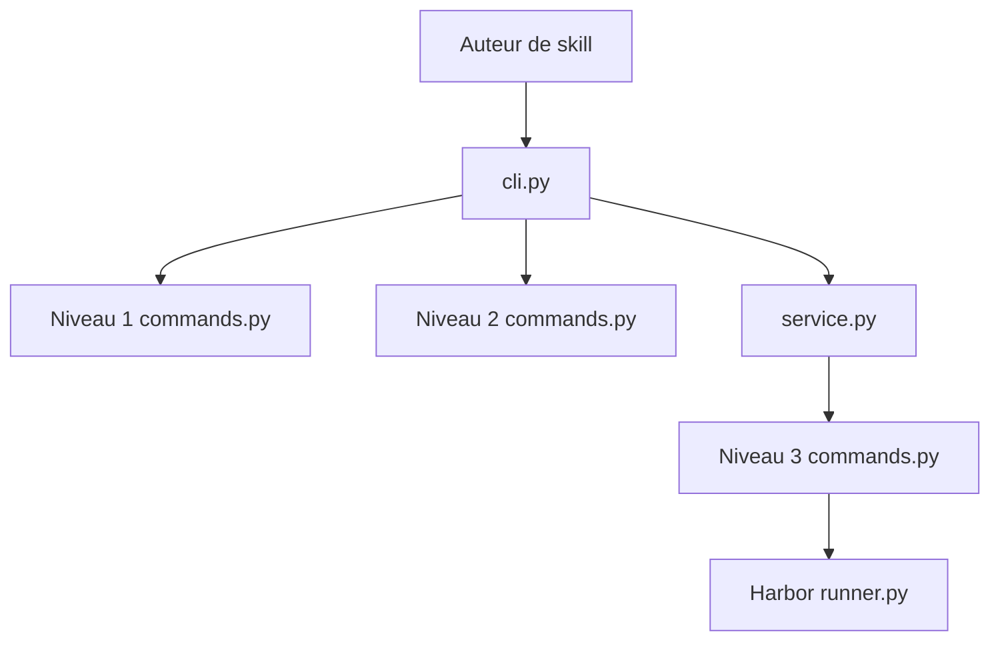

# NVIDIA/SkillEvaluator

> Outil libre qui contrôle la qualité des skills d'agents IA et mesure leur effet sur les tâches.

## Le problème
Un skill d'agent peut être mal écrit, dangereux ou inutile, et rien ne le montre avant de l'essayer en vrai.

## Ce que ça fait vraiment
- Niveau 1 : validation statique, avec score et analyse de sécurité (SkillSpector, Gitleaks).
- Niveau 2 : détection de doublons et de recoupements de consignes par embeddings.
- Niveau 3 : exécution réelle avec et sans le skill, via Harbor et un bac à sable Docker.
- Rapports HTML et modèles d'intégration continue pour GitHub et GitLab.

## Comment c'est branché


## Essayer
```bash
pip install --upgrade skillevaluator
skillevaluator ci init
uv run --python 3.13 skillevaluator quality-check src/skillevaluator/tier3/reference_skills/text-analyzer -r cli -r json -o reports/first-quality
```

## Coût et pièges
Le contrôle de qualité de base ne demande ni clé ni GPU. Les niveaux avec modèle demandent une clé NVIDIA Build ou un fournisseur, et le niveau 3 un bac à sable Docker ; l'usage de modèles peut être facturé.

## Ce que ce n'est pas
Pas un benchmark de modèles : il évalue des skills. Un score statique ne prouve pas l'effet sur l'agent ; l'évidence de publication reste incomplète sans niveau 3.

## Alternatives
Aucune alternative nommée dans le README.

## Pour toi
À adopter : si tu écris des skills pour des agents, l'étape sans LLM donne un retour déterministe immédiat et les niveaux suivants mesurent l'effet réel.

