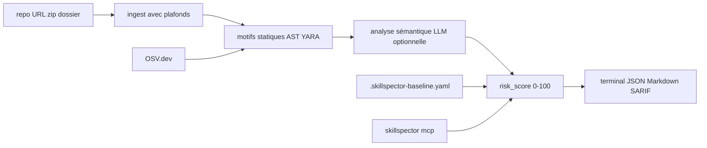

# NVIDIA/SkillSpector

> Security scanner for agent skills: it analyzes them before you install them.

## The problem
An agent skill runs with implicit trust and almost no prior verification.
In the analyzed subset of 31,132 skills, 26.1% have vulnerabilities and 5.2% show probable malicious intent.

## What it actually does
Analyzes Git repositories, URLs, zips, directories or single files, and answers "is it safe to install?".
71 patterns across 17 categories: prompt injection, exfiltration, escalation, supply chain, AST, taint tracking, YARA, MCP.
Two stages: fast static analysis, then optional semantic evaluation by an LLM (`--no-llm` to skip it).
Risk score 0-100 with a recommendation, terminal, JSON, Markdown or SARIF output, and a baseline for false positives.

## How it is wired


## Trying it
```bash
uv tool install git+https://github.com/NVIDIA/skillspector.git
skillspector scan ./my-skill/
skillspector scan ./my-skill/ --no-llm --format json --output report.json
claude mcp add skillspector -- skillspector mcp
```
In a container: `make docker-build` then `docker run --rm -v "$PWD:/scan" skillspector scan ./my-skill/ --no-llm`.

## Cost and gotchas
The LLM analysis requires a key with the chosen provider (the default configuration targets DeepSeek, announced
as going away). The MCP server's HTTP transport ships without authentication.

## What it is not
Not a guarantee: a low score from a static scan alone is not equivalent to a full scan, hence the `llm_used` / `scan_mode` fields.
Not a trust signature: signed publication belongs to the NVIDIA Verified Skills pipeline, not to this tool.
Not a general-purpose code scanner: it targets skills and MCP servers.

## Alternatives
None named in the README.

## For you
Use it as a guardrail before installing any third-party skill — `--no-llm` is enough for a free first filter.
