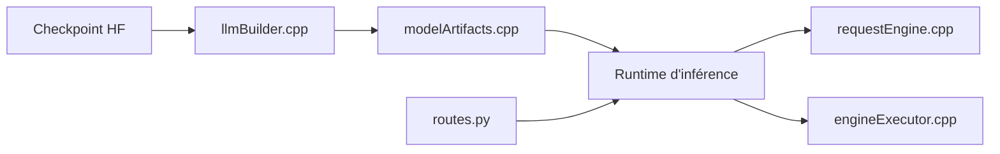

# NVIDIA/TensorRT-Edge-LLM

> NVIDIA C++ runtime for inference of text, vision, audio and action models on Jetson, DRIVE and DGX Spark.

## The problem
Running LLMs and multimodal models on embedded hardware requires an engine optimized for these boards.

## What it actually does
Exports a Hugging Face checkpoint to ONNX then builds TensorRT engines, or uses an experimental direct builder. The C++ runtime handles scheduling, KV cache, context reuse, speculative decoding and multi-device. An OpenAI-compatible Python server is experimental.

## How it is wired


## Trying it
```bash
python -m pip install "tensorrt-edgellm[server]"
```

## Cost and gotchas
NVIDIA hardware (Jetson, DRIVE, DGX Spark) and a compatible CUDA and TensorRT stack. Check compatibility in the official matrix. 136 open issues.

## What it is not
It is not an engine for generic desktop GPUs. The server and the direct builder are experimental.

## Alternatives
No alternative named in the README.

## For you
Watch: relevant if you deploy models on Jetson or embedded systems, of no interest without this NVIDIA hardware.
