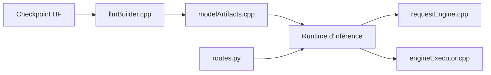

# NVIDIA/TensorRT-Edge-LLM

> Runtime C++ NVIDIA pour l'inférence de modèles texte, vision, audio et action sur Jetson, DRIVE et DGX Spark.

## Le problème
Faire tourner des LLM et modèles multimodaux sur du matériel embarqué demande un moteur optimisé pour ces cartes.

## Ce que ça fait vraiment
Exporte un checkpoint Hugging Face en ONNX puis construit des moteurs TensorRT, ou utilise un constructeur direct expérimental. Le runtime C++ gère ordonnancement, cache KV, réutilisation de contexte, décodage spéculatif et multi-appareil. Un serveur Python compatible OpenAI est expérimental.

## Comment c'est branché


## Essayer
```bash
python -m pip install "tensorrt-edgellm[server]"
```

## Coût et pièges
Matériel NVIDIA (Jetson, DRIVE, DGX Spark) et pile CUDA et TensorRT compatible. Compatibilité à vérifier dans la matrice officielle. 136 issues ouvertes.

## Ce que ce n'est pas
Ce n'est pas un moteur pour GPU de bureau générique. Le serveur et le constructeur direct sont expérimentaux.

## Alternatives
Aucune alternative nommée dans le README.

## Pour toi
À surveiller : pertinent si tu déploies des modèles sur Jetson ou en embarqué, sans intérêt sans ce matériel NVIDIA.

