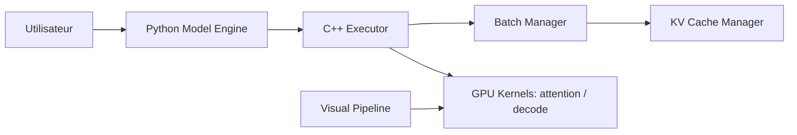

# NVIDIA/TensorRT-LLM

> Inference library for LLMs and visual generation models on NVIDIA GPUs, with specialized kernels.

## The problem
Serving a large model on GPU with good throughput requires custom kernels and a suitable runtime (KV cache, parallelism, speculative decoding).

## What it actually does
Kernels for attention, GEMM and MoE, runtime optimizations (prefill/decode disaggregation, wide expert parallelism, speculative decoding) and a Python LLM API on PyTorch, from one GPU to multiple nodes. It integrates with NVIDIA Dynamo and Triton. Video/image generation pipelines are also provided.

## How it is wired

## Trying it
The README gives no install command: it points to the Quick Start and the Installation Guide in the documentation.

## Cost and gotchas
NVIDIA GPU. Anonymous telemetry is on by default (GPU, model, configuration); opt out with `TRTLLM_NO_USAGE_STATS=1`, `DO_NOT_TRACK=1`, the file `~/.config/trtllm/do_not_track` or `--no-telemetry`. License present but not identified by GitHub.

## What it is not
Not a complete inference service: serving is done with `trtllm-serve` or Dynamo. Does not work on other GPUs.

## Alternatives
NVIDIA Dynamo and Triton Inference Server (cited as integrations); AutoDeploy for deploying PyTorch models.

## For you
Adopt it if you serve LLMs on NVIDIA GPUs at high volume; check the license and disable telemetry if needed.
