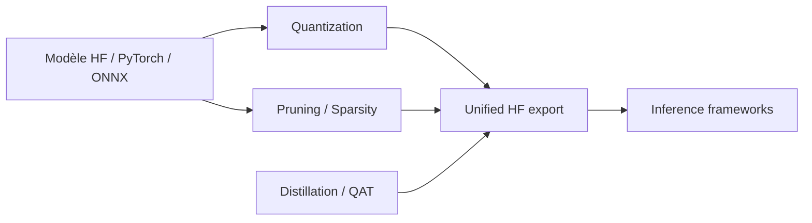

# NVIDIA/TensorRT-Model-Optimizer

> Library for quantization, pruning, distillation and speculative decoding to speed up models.

## The problem
A model that is too heavy costs a lot in memory and latency; it has to be compressed without losing too much quality.

## What it actually does
ModelOpt takes a Hugging Face, PyTorch or ONNX model and applies post-training or quantization-aware training quantization, pruning, architecture search, distillation, speculative decoding and sparsity. It exports a quantized checkpoint deployable on TensorRT-LLM, vLLM, SGLang or TensorRT. Integration with Megatron-Bridge, Megatron-LM and Accelerate. Pre-quantized checkpoints are on Hugging Face.

## How it is wired


## Trying it
```bash
pip install -U nvidia-modelopt[all]
```
```bash
git clone git@github.com:NVIDIA/Model-Optimizer.git
cd Model-Optimizer
pip install -e .[dev]
```

## Cost and gotchas
An NVIDIA GPU for the expected gains. Installation downloads third-party dependencies whose licenses should be re-read. Before 1.0: a migration period of only one month after deprecation.

## What it is not
Not an inference server: it prepares checkpoints. The API changes fast (version 0.x).

## Alternatives
No alternative named in the README; TensorRT-LLM, vLLM and SGLang are deployment targets.

## For you
Adopt it if you deploy LLMs on NVIDIA GPUs and want to reduce memory: it is the tool from the same vendor as the runtime, with an unstable API to keep an eye on.
