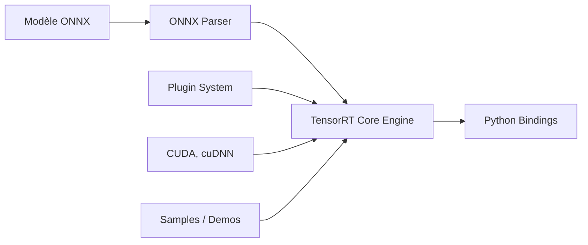

# NVIDIA/TensorRT

> Open source components of TensorRT (plugins, ONNX parser, samples) to accelerate inference on NVIDIA GPUs.

## The problem
Serving models in production on GPU requires optimized inference, which training frameworks do not provide.

## What it actually does
The repository contains the sources of the plugins, the ONNX parser, the Python bindings, demos and samples. It relies on the GA build of TensorRT (11.4) and on CUDA, and is built with CMake, Docker and cross-toolchains (Jetson, DriveOS, QNX). TensorRT 11 removes weakly-typed networks, implicit quantization, IPluginV2 and the TREX tool. Coding-agent skills are provided.

## How it is wired


## Trying it
```bash
pip install tensorrt
git clone -b main https://github.com/nvidia/TensorRT TensorRT
cd TensorRT && git submodule update --init --recursive
./docker/build.sh --file docker/ubuntu-24.04.Dockerfile --tag tensorrt-ubuntu24.04-cuda13.4
```

## Cost and gotchas
Free, but you need an NVIDIA GPU, CUDA and the TensorRT GA package downloaded separately. Moving from 10.x to 11.x requires a migration. 669 open issues.

## What it is not
Not the full engine: the TensorRT core is not in this repository, only plugins, parsers and samples are. Not usable without NVIDIA hardware.

## Alternatives
No alternative named in the README.

## For you
Adopt it if you deploy models on NVIDIA GPUs: the reference for optimized inference, Apache-2.0, backed by NVIDIA.
